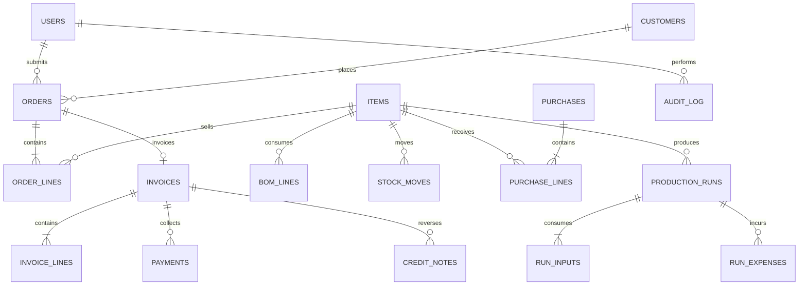

# Data model and transaction design

## Entity relationship



## Core records

| Table | Purpose |
| --- | --- |
| `users` | Role, login name and scrypt password hash. |
| `customers`, `suppliers` | Business parties, state/GSTIN, and assigned salesman. |
| `items` | Finished goods, raw materials and packaging with SKU, stock unit, HSN, tax, prices and reorder level. |
| `recipes`, `bom_lines` | Expected finished output and standard quantity of each item per product batch. |
| `orders`, `order_lines` | Submitted salesman orders, list price, approved price/quantity, and state. |
| `invoices`, `invoice_lines` | Immutable posted invoice number, supply state, taxable value and tax components. |
| `dispatches` | Dispatch confirmation linked to the order and invoice. |
| `purchases`, `purchase_lines` | Supplier receipt, source reference, unit rate, quantity, lot and expiry. |
| `production_runs`, `run_inputs`, `run_expenses` | Planned and actual output, issue quantities, variance inputs and run overheads. |
| `stock_moves` | Signed movement ledger. On-hand is `SUM(qty_milli)` per item. A movement carries source type/id, reference, actor, unit cost, lot and expiry. |
| `payments`, `credit_notes` | Collections and invoice reversals without deleting the original invoice. |
| `audit_log` | Actor, timestamp, action, entity and details for important postings. |

## Stock posting rules

- Opening balances and purchase receipts are positive ledger movements.
- A production run writes one negative movement per recipe input and a positive movement for actual good output. A damaged pouch is included in actual packaging consumption and its damage count is recorded separately as production detail.
- A dispatch writes a negative finished-goods movement. Invoice approval reserves stock while an invoice awaits dispatch, preventing another approval from promising the same packets.
- A returned dispatch writes positive finished-goods movements only when the credit-note action records goods returned.
- An adjustment must have a reason and cannot take on-hand below zero.
- Stock changes and their source document, run details and audit record are committed in one SQLite transaction.

## Units and money

Quantities are stored as integer thousandths of the item's stock unit. The BOM editor accepts mass (`kg`/`g`) and volume (`litre`/`ml`) quantities and normalizes them to the material's stock unit. A finished product can specify its packet count per carton; salesman carton orders convert to the product's packet stock unit using that saved pack size. Piece, packet and carton remain separate count units for materials because a packaging carton's contents are a product-specific recipe rule.

All stored money is integer paise. Taxable values are rounded per invoice line to paise; line tax is computed using the line's GST basis points and totals are summed. Intra-state tax is split between CGST and SGST; inter-state tax is assigned to IGST. Quantity × paise calculations use integer thousandths and integer division with half-up rounding.

## Valuation and unit cost

For each material, weighted-average purchase cost is computed as:

`sum(receipt quantity × receipt unit price) / sum(receipt quantity)`

The run valuation retains the weighted rate as a rational numerator/denominator and rounds only the consumed line's paise amount. This preserves the exact ₹43.125/kg flour rate in the benchmark. Run cost adds actual raw and packaging consumption plus directly assigned labour, gas/power and other expenses. Good output cost is `run cost / actual good output`; the benchmark run is ₹5,855 / 188 = ₹31.1436, displayed as ₹31.14 per packet.

## Order and invoice state

```text
submitted ── admin approves ──> invoiced ── dispatch posts ──> dispatched
    │                               │
    ├─ insufficient stock ──> shortage
    └─ admin rejects ───────> rejected
                                    
posted invoice ── full credit note ──> credited
```

Approval verifies stock, permits a logged admin price/quantity adjustment, creates the FY-numbered invoice and leaves stock reserved until dispatch. A posted invoice is never removed. A full credit note marks its invoice/order credited, records the reversal and optionally adds returned goods back into stock. The current implementation blocks credit notes after a payment is posted; refunds need an explicit future payment-reversal workflow.

## Benchmark result derivation

- Flour: 100 + 60 − 40 = **120 kg**.
- Oil: 30 − 10.5 = **19.5 L**.
- Spice: 5 − 1.2 = **3.8 kg**.
- Pouches: 500 − 194 consumed (188 good + 6 damaged) = **306**.
- Cartons: 30 − 9 = **21**.
- Finished stock: 50 + 188 = **238**; after dispatch 238 − 150 = **88**.
- Yield variance: (188 − 200) / 200 = **−6%**. Oil variance: (10.5 − 10) / 10 = **+5%**. Both exceed the 3% tolerance.
- Tamil Nadu invoice: ₹7,500 taxable at 5%; CGST ₹187.50 and SGST ₹187.50. Total ₹7,875; after ₹4,000 collected, balance ₹3,875.
- Karnataka order checks the 88 available packets and reports a 32 packet shortage before invoicing. An invoiced Karnataka sale uses IGST.
